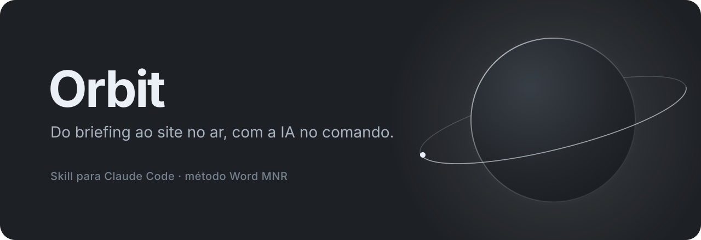
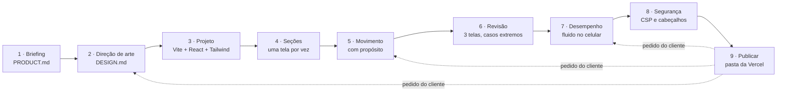

<p align="center">
  
</p>

<p align="center">
  <a href="LICENSE"></a>
  <a href="https://github.com/miguelribeirovie-coder/orbit/actions/workflows/validar.yml"></a>
  
  
  
</p>

**Orbit** é uma skill para o [Claude Code](https://code.claude.com) que transforma a IA num estúdio
completo de criação de sites. Ela junta, num roteiro só, o método usado para criar o site da
**Word MNR** e as 16 melhores skills de design do momento: direção de arte, sistema de design,
animação, revisão, desempenho no celular, segurança e publicação na Vercel.

Você pede *"cria um site para a minha padaria"* e a IA conduz o projeto como um estúdio faria:
pergunta antes de desenhar, escolhe uma direção visual própria para o cliente, constrói, anima com
propósito, testa em três telas, mede a fluidez, fecha a segurança e entrega a pasta pronta para publicar.

> **Por que Orbit?** O planeta de vidro é a marca do método (ele nasceu no site da Word MNR). Aqui,
> 16 skills giram em volta de um roteiro só, e todo projeto termina do mesmo jeito: o site no ar, em órbita.

---

## Sumário

- [Instalar](#instalar)
- [Usar](#usar)
- [Como funciona](#como-funciona)
- [As regras de ouro](#as-regras-de-ouro)
- [As 16 skills incluídas](#as-16-skills-inclu%C3%ADdas)
- [O que tem no repositório](#o-que-tem-no-reposit%C3%B3rio)
- [Atualizar e desinstalar](#atualizar-e-desinstalar)
- [Perguntas frequentes](docs/faq.md)
- [Licença e créditos](#licen%C3%A7a-e-cr%C3%A9ditos)

## Instalar

Você precisa do [Node.js](https://nodejs.org) 18 ou mais novo (22+ para os scripts de direção de arte)
e do Claude Code. O instalador copia a skill para `~/.claude/skills/orbit` e baixa as 16 skills
de terceiros direto dos repositórios dos autores, na versão testada com o método.

**Mac e Linux**

```bash
curl -fsSL https://raw.githubusercontent.com/miguelribeirovie-coder/orbit/main/instalar.sh | sh
```

**Windows (PowerShell)**

```powershell
irm https://raw.githubusercontent.com/miguelribeirovie-coder/orbit/main/instalar.ps1 | iex
```

**Pelo repositório (qualquer sistema)**

```bash
git clone https://github.com/miguelribeirovie-coder/orbit.git
cd orbit
node instalar.mjs
```

<details>
<summary><b>Outras formas: plugin do Claude Code, só neste projeto, opções do instalador</b></summary>

**Como plugin do Claude Code** (atualiza pelo próprio `/plugin` e já registra o MCP de componentes shadcn):

```text
/plugin marketplace add miguelribeirovie-coder/orbit
/plugin install orbit@word-mnr
```

Na primeira vez que a skill rodar, ela mesma baixa as skills de terceiros que faltarem.

**Só neste projeto** (em `./.claude/skills`, bom para versionar junto com o site):

```bash
node instalar.mjs --projeto
```

**Opções do instalador**

| Opção | O que faz |
|---|---|
| `--projeto` | instala em `./.claude/skills` em vez da pasta do usuário |
| `--destino <pasta>` | instala em outra pasta de skills |
| `--dentro` | guarda as 16 skills dentro de `orbit/skills` (não aparecem soltas na lista do Claude) |
| `--sem-terceiros` | instala só o método |
| `--shadcn` | registra o MCP de componentes shadcn no Claude Code |
| `--forcar` | troca skills com o mesmo nome que você já tinha instaladas |
| `--mais-recente` | baixa a versão mais nova de cada skill de terceiros, em vez da testada |

Com o instalador remoto, passe as opções assim: `curl -fsSL …/instalar.sh | sh -s -- --dentro`
(Mac/Linux) ou `& ([scriptblock]::Create((irm …/instalar.ps1))) --dentro` (Windows).

</details>

Uma vez por computador, registre os componentes shadcn (o plugin já faz isso sozinho):

```bash
claude mcp add shadcn -s user -- npx -y @jpisnice/shadcn-ui-mcp-server
```

## Usar

Abra uma sessão **nova** do Claude Code e peça do seu jeito. A skill entra sozinha:

```text
cria um site para a minha barbearia
quero uma landing page futurista para a minha clínica
faz um portfólio para uma arquiteta, sóbrio e elegante
deixa esse site mais leve no celular
prepara esse projeto para subir na Vercel
```

Ou chame direto com `/orbit`. Mais exemplos, por tipo de pedido, em
[docs/exemplos-de-pedidos.md](docs/exemplos-de-pedidos.md).

## Como funciona

A primeira versão de um site passa pelas nove fases em ordem. Depois, cada pedido do cliente volta só
à fase que importa, e toda rodada termina publicável.



| Fase | O que sai | Skills que entram |
|---|---|---|
| 1. Briefing | `PRODUCT.md`: quem, para quem, provas reais, contatos | — |
| 2. Direção de arte | `DESIGN.md` e a folha de direção | design-taste-frontend, impeccable |
| 3. Projeto | Vite + React + TS + Tailwind 4 + shadcn + Motion, HTML pré-renderizado | pick-ui-library |
| 4. Seções | a página, uma tela por vez, conteúdo em `src/content.ts` | prototype |
| 5. Movimento | entradas, demonstração, rolagem presa, brilhos | animate, apple-design, emil-design-eng, animation-vocabulary |
| 6. Revisão | inspector em navegador real, lint, crítica, casos extremos | impeccable, break-ui, mobile-native, review-animations |
| 7. Desempenho | sem travar no celular, carregamento leve | animation-performance, remove-animations |
| 8. Segurança | cabeçalhos, CSP, dependências | — |
| 9. Publicar | pasta pronta para a Vercel | — |

O passo a passo de cada fase está em [`skills/orbit/references/`](skills/orbit/references) e
uma visão mais detalhada em [docs/como-funciona.md](docs/como-funciona.md).

## As regras de ouro

Aprendidas com cliente de verdade, e seguidas pela IA em todo projeto:

1. **Pergunte antes de desenhar.** Público, ramo, tom, cores, referências, contatos e o que *não* quer.
2. **Referência é inspiração, nunca molde.** Copiar o tema de um site é o erro que o cliente mais nota.
3. **A paleta sai da logo.** Poucas cores, contraste AA, nada de neon sem pedido.
4. **Títulos em até duas linhas.** Aberturas centralizadas; listas e textos longos à esquerda.
5. **Nada inventado.** Sem depoimentos, números ou clientes falsos.
6. **Movimento com propósito e com saída.** Toda animação respeita o "movimento reduzido".
7. **Teste de verdade, em três telas:** 1280×800, 650×540 e 375×812, sem nada cortado.
8. **Toda alteração termina publicável:** build sem erro e pasta da Vercel atualizada.
9. **Mostre e confirme o caminho** antes de construir tudo.

## As 16 skills incluídas

Elas **não** ficam copiadas aqui: o instalador baixa cada uma do repositório do autor, no commit exato
fixado em [`skills.lock.json`](skills/orbit/skills.lock.json), e leva a licença junto.

| Skill | Autor | Licença | Para que serve no método |
|---|---|---|---|
| [design-taste-frontend](https://github.com/Leonxlnx/taste-skill) | Leonxlnx | MIT | direção de arte, anti "cara de IA", inspector em navegador real |
| [impeccable](https://github.com/pbakaus/impeccable) | Paul Bakaus | Apache 2.0 | PRODUCT.md / DESIGN.md, crítica, auditoria, polimento |
| [animate](https://github.com/emilkowalski/skills) | Emil Kowalski | MIT | decidir e escrever qualquer animação |
| [apple-design](https://github.com/emilkowalski/skills) | Emil Kowalski | MIT | molas, vidro, profundidade, tipografia estilo Apple |
| [emil-design-eng](https://github.com/emilkowalski/skills) | Emil Kowalski | MIT | acabamento de componentes e detalhes invisíveis |
| [animation-performance](https://github.com/emilkowalski/skills) | Emil Kowalski | MIT | animação travando: propriedades baratas, camadas |
| [animation-vocabulary](https://github.com/emilkowalski/skills) | Emil Kowalski | MIT | dar nome ao efeito que o cliente descreve |
| [find-animation-opportunities](https://github.com/emilkowalski/skills) | Emil Kowalski | MIT | onde o movimento ajuda (e onde não) |
| [improve-animations](https://github.com/emilkowalski/skills) | Emil Kowalski | MIT | auditoria de todas as animações |
| [review-animations](https://github.com/emilkowalski/skills) | Emil Kowalski | MIT | revisão rigorosa de animações |
| [remove-animations](https://github.com/emilkowalski/skills) | Emil Kowalski | MIT | enxugar quando ficou "pesado" |
| [mobile-native](https://github.com/emilkowalski/skills) | Emil Kowalski | MIT | sensação de app no celular |
| [break-ui](https://github.com/emilkowalski/skills) | Emil Kowalski | MIT | testes com dados extremos |
| [pick-ui-library](https://github.com/emilkowalski/skills) | Emil Kowalski | MIT | escolher a biblioteca de componentes |
| [prototype](https://github.com/emilkowalski/skills) | Emil Kowalski | MIT | prototipar rápido |
| [ask-sonner](https://github.com/emilkowalski/skills) | Emil Kowalski | MIT | avisos (toasts) com Sonner |

Os detalhes de cada fonte estão em [CREDITOS.md](CREDITOS.md).

## O que tem no repositório

```text
orbit/
├── instalar.mjs              instalador (Windows, Mac e Linux)
├── instalar.sh · instalar.ps1  instaladores de uma linha
├── skills/orbit/        a skill em si
│   ├── SKILL.md              o roteiro: regras de ouro, fases, comandos, mapa das skills
│   ├── references/           uma página por fase + lições do projeto Word MNR
│   ├── templates/            código real do site: config, scripts, componentes, CSS, medições
│   ├── ferramentas/          baixar-skills.mjs e verificar.mjs
│   └── skills.lock.json      fonte, commit e licença de cada skill de terceiros
├── docs/                     como funciona, exemplos de pedidos, perguntas frequentes
├── .claude-plugin/           manifesto de plugin e marketplace do Claude Code
└── .github/                  validação automática, modelos de issue e de pull request
```

Ferramentas que você (ou a IA) pode rodar a qualquer momento:

```bash
node skills/orbit/ferramentas/baixar-skills.mjs --verificar   # o que está instalado
node skills/orbit/ferramentas/baixar-skills.mjs --listar      # skills, autores e licenças
node skills/orbit/ferramentas/verificar.mjs --completo        # confere a skill inteira
```

## Atualizar e desinstalar

**Atualizar:** rode o instalador de novo (o de uma linha ou `git pull && node instalar.mjs`). Ele troca
o método e as skills que ele mesmo instalou, e nunca mexe numa skill sua com o mesmo nome (a não ser
com `--forcar`).

**Desinstalar:** apague `~/.claude/skills/orbit`. As skills de terceiros instaladas por ele têm um
arquivo `.orbit.json` dentro; apague essas pastas também se não quiser mais usá-las.

## Contribuir

Achou um erro, tem uma lição nova de cliente ou uma skill que merece entrar? Veja
[CONTRIBUTING.md](CONTRIBUTING.md). Toda mudança passa pela validação automática em Linux, Mac e Windows.

## Licença e créditos

O método (o `SKILL.md`, `references/`, `templates/`, `ferramentas/` e os instaladores) é da
**Word MNR**, sob a [licença MIT](LICENSE).

As skills incluídas pertencem aos autores e seguem as licenças deles: Emil Kowalski
([emilkowalski/skills](https://github.com/emilkowalski/skills), MIT), Leonxlnx
([taste-skill](https://github.com/Leonxlnx/taste-skill), MIT) e Paul Bakaus
([impeccable](https://github.com/pbakaus/impeccable), Apache 2.0). Obrigado a eles pelo trabalho aberto.
