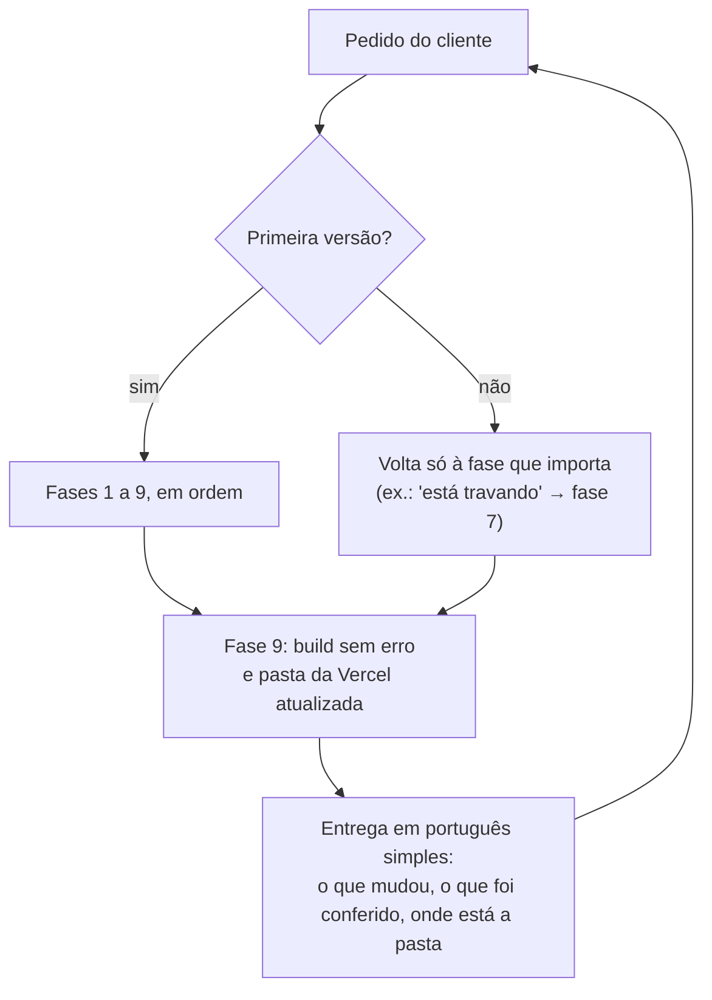

# Como funciona

O Orbit não é um gerador de templates. É um roteiro de trabalho que a IA segue como um estúdio
seguiria, com uma regra por fase e ferramentas que conferem o resultado de verdade, num navegador.

## O ciclo

## As fases, uma a uma

### 1. Briefing → `PRODUCT.md`
Uma rodada de perguntas curtas, com opções: negócio, público, objetivo do site, ponto de partida,
cores e logo, referências, tom, preços, provas reais e contatos. O que não existe vira `[placeholder]`
visível, nunca um número ou depoimento inventado. Detalhes: `references/01-briefing.md`.

### 2. Direção de arte → `DESIGN.md`
A IA tira uma direção do "baralho" da design-taste-frontend (`draw.mjs`), escolhe a que consegue
carregar algo que só aquele cliente tem e escreve o `DESIGN.md` com a impeccable: tokens de cor com
nome, tipos, espaços, movimento. A paleta sai da logo. Detalhes: `references/02-direcao.md`.

### 3. Projeto
Vite + React + TypeScript, Tailwind CSS 4, componentes shadcn (pelo MCP), Motion e HTML
pré-renderizado (o site abre rápido e é lido pelo Google). Detalhes: `references/03-stack.md`.

### 4. Seções
Uma tela por vez, com todo o conteúdo num arquivo só (`src/content.ts`). Títulos em até duas linhas.
Os modelos em `templates/src/*.exemplo.tsx` mostram seções completas. Detalhes: `references/04-secoes.md`.

### 5. Movimento
Toda animação tem propósito, curva, duração e saída para quem prefere "movimento reduzido". Animações
ligadas à rolagem mostram a mensagem principal até a metade do trecho. Detalhes: `references/05-movimento.md`.

### 6. Revisão
`inspect.mjs` abre o site num navegador real em várias larguras e mede as regras da casa; `lint.mjs`
confere o código. Depois vêm a crítica da impeccable, os casos extremos (break-ui), o celular de verdade
(mobile-native) e a revisão das animações. Detalhes: `references/06-revisao.md`.

### 7. Desempenho
O que trava celular quase nunca é o tamanho do download, é o trabalho de desenhar. Os scripts de
`templates/medicao/` medem a rolagem quadro a quadro e procuram qualquer coisa passando da largura da
tela. Detalhes: `references/07-desempenho.md`.

### 8. Segurança
Cabeçalhos de segurança e CSP no `vercel.json`, hash dos scripts embutidos, `npm audit` do que vai para
o ar. Detalhes: `references/08-seguranca.md`.

### 9. Publicar
`npm run vercel:pasta` gera a pasta só com o site final, pronta para `npx vercel --prod` ou para subir
no GitHub e importar na Vercel. Detalhes: `references/09-publicar.md`.

## As três telas

Todo site é conferido em:

| Tela | Tamanho | Por quê |
|---|---|---|
| Computador | 1280 × 800 | o caso comum |
| Tela baixa | 650 × 540 | notebook pequeno, janela dividida: onde elemento grande corta |
| Celular | 375 × 812 | a maioria das visitas |

## Onde ficam as skills de terceiros

O `SKILL.md` procura cada skill nesta ordem: `orbit/skills/<nome>`, depois `~/.claude/skills/<nome>`,
depois `.claude/skills/<nome>` no projeto. Se nenhuma existir, a própria IA roda
`ferramentas/baixar-skills.mjs` e continua.
